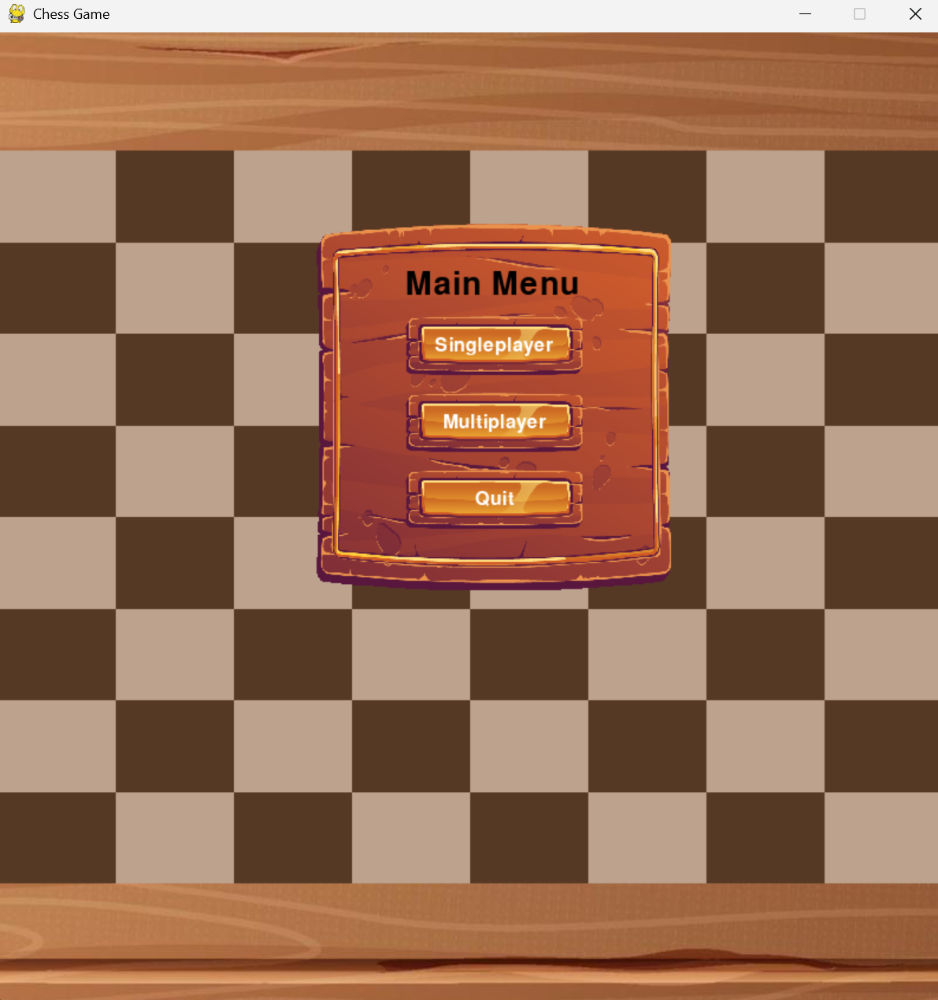
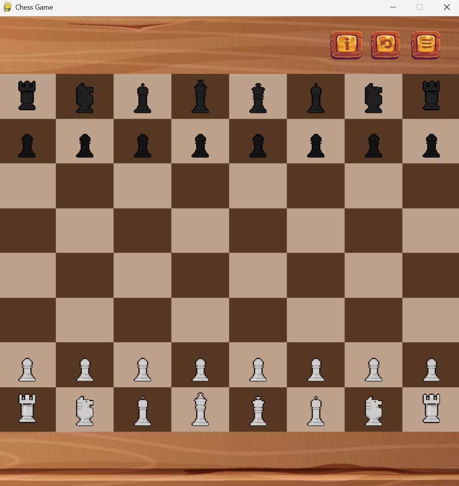
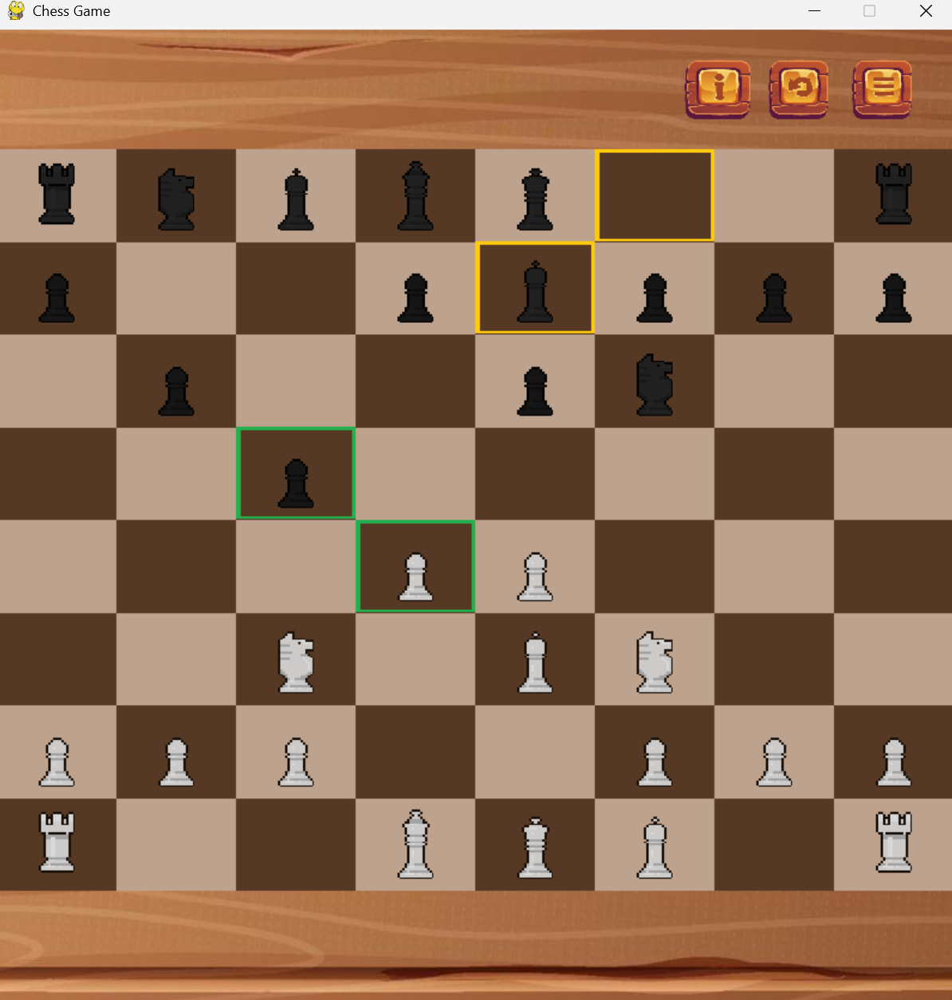

# Chess Game

A desktop chess application developed in Python using Pygame and NumPy, with custom chess-rule handling, a Minimax-based computer opponent, Stockfish integration, move history, and Socket.IO-based multiplayer support.

This project was developed during my undergraduate studies as my sixth-semester academic project.

## Academic Context and Contribution

The project was **formally assigned and submitted as a group project**, but I was responsible for the design and essentially all of the application's implementation.

One small multiplayer/server-related contribution was submitted by a classmate through a GitHub pull request during development. I later modified and integrated the multiplayer implementation into the rest of the application. The core chess logic, game state, user interface, move handling, custom bot, Stockfish integration, history system, and the broader application were implemented by me.

The repository is preserved largely as it was developed at the time. It therefore also reflects some of the architectural and design limitations of an early undergraduate project.

---

## Screenshots

### Main Menu



### Game



### Move Recommendation



---

# Features

## Chess Gameplay

The application implements its own representation of the chess board and piece state.

The board is stored as an 8×8 NumPy array, with individual pieces represented using identifiers such as:

```text
white_pawn1
black_rook2
white_king
black_queen1
```

Move generation is implemented separately for:

- Pawns
- Knights
- Bishops
- Rooks
- Queens
- Kings

Candidate moves are additionally filtered by simulating the move and checking whether the player's king would remain in check.

The implementation includes handling for:

- Piece movement and captures
- Check detection
- Checkmate detection
- Stalemate detection
- Castling
- En passant
- Pawn promotion
- Move highlighting
- Captured-piece display
- Previous-move highlighting

The chess-rule implementation is custom rather than delegated to an external chess engine.

---

## Single-Player Mode

The game provides multiple difficulty selections.

### Easy Bot — Custom Minimax Search

The Easy bot uses a custom recursive Minimax implementation with alpha-beta pruning.

For each candidate move, the algorithm:

1. applies the move to the current board state;
2. recursively evaluates responses from the opposing side;
3. restores the previous board state;
4. propagates maximizing/minimizing scores through the search tree;
5. performs alpha-beta cutoffs when possible.

The evaluation function is intentionally simple and assigns material values to pieces:

| Piece | Value |
|---|---:|
| Pawn | 1 |
| Knight | 3 |
| Bishop | 3 |
| Rook | 5 |
| Queen | 9 |
| King | 1000 |

The game currently invokes the Easy bot with a shallow search depth, so this should be viewed as an educational Minimax implementation rather than a competitive chess engine.

### Medium Bot

A Medium difficulty option exists in the interface, but the corresponding bot implementation was not completed.

It should therefore be considered **unfinished**.

### Hard Bot — Stockfish

The Hard difficulty uses the external **Stockfish chess engine**.

The application reconstructs the move sequence from the start of the game and passes it to Stockfish, which is then queried for its best move.

Stockfish is an external engine and is **not part of the custom chess AI implementation**.

---

# Move Recommendation

The application can request a move recommendation from Stockfish during a game.

The current game history is provided to Stockfish, and the returned move is mapped back to the application's internal board representation and highlighted on the interface.

This feature is separate from the custom Minimax bot.

---

# Undo and Redo

Move history is stored using a custom doubly linked structure.

Each history node contains the state associated with a move and links to the previous and next states.

The stored move information includes data needed to reconstruct special cases such as:

- captures;
- castling;
- promotion;
- en passant.

This history is used by the application's undo/redo functionality.

---

# Multiplayer

The project contains a basic online multiplayer implementation using Socket.IO.

The architecture consists of:

```text
Chess Application
      │
      │ python-socketio
      ▼
Socket.IO Server
      │
      ├── Player 1
      │
      └── Player 2
```

The client sends move-state information to the server, which forwards the message to the paired opponent.

The server:

- tracks connected clients in memory;
- assigns a color to the first player;
- gives the next player the opposite color;
- pairs clients according to connection order;
- forwards moves between paired clients.

The client then applies the opponent's move to its local game state.

This is a relatively simple multiplayer implementation and does not use persistent rooms, accounts, authentication, databases, or persistent game sessions.

The current client contains a hard-coded hosted server address, so multiplayer availability depends on that deployment still being active.

---

# Architecture

The application is divided across several Python modules.

### `Chess.py`

Application entry point.

Creates the `GameController`, displays menus, initializes pieces, and starts the game loop.

### `GameController.py`

Acts as the primary application controller.

It currently handles a large portion of the program, including:

- the Pygame game loop;
- menu handling;
- game initialization;
- bot turns;
- Stockfish communication;
- multiplayer move synchronization;
- promotion;
- captured-piece display;
- game-over detection;
- move recommendations;
- undo/redo interaction;
- sound effects.

### `ChessData.py`

Stores most shared game state.

This includes:

- the NumPy board representation;
- current turn;
- selected piece;
- castling state;
- en-passant state;
- promotion state;
- captured pieces;
- move history;
- multiplayer state;
- bot settings.

Most of this state is implemented using class-level variables and class methods.

### `ChessPiece.py`

Represents chess pieces as Pygame sprites and contains much of the chess-rule implementation.

Responsibilities include:

- drag-and-drop interaction;
- piece-specific move generation;
- move visualization;
- capture handling;
- castling-related move generation;
- en-passant handling;
- king-safety filtering;
- check detection;
- checkmate-related logic.

### `ChessBoard.py`

Handles rendering of the board and maintains the Pygame sprite collection representing active chess pieces.

### `Node.py`

Contains the custom linked structure used for move history and undo/redo navigation.

### `client.py`

Implements the Socket.IO multiplayer client.

It handles:

- server connection;
- disconnection;
- initial color assignment;
- sending moves;
- receiving opponent moves.

### `server.py`

Implements the Flask-SocketIO multiplayer server.

It tracks connected clients and forwards move messages between paired players.

---

# Main Technologies

## Core

- Python
- Pygame
- NumPy

## Multiplayer

- python-socketio
- Flask
- Flask-SocketIO
- Eventlet

## External Chess Engine

- Stockfish

Stockfish is used for:

- Hard difficulty
- Move recommendations

It is **not** used to implement the Easy Minimax bot or the application's custom chess-rule logic.

---

# Running the Project

## 1. Clone the repository

```bash
git clone https://github.com/BipinRana/Chess-Game.git
cd Chess-Game
```

## 2. Create a virtual environment

On Windows:

```bash
python -m venv .venv
.venv\Scripts\activate
```

On Linux/macOS:

```bash
python3 -m venv .venv
source .venv/bin/activate
```

## 3. Install dependencies

```bash
pip install -r requirements.txt
```

The source also imports the Python `stockfish` wrapper. If it is not already installed through the environment, install it separately:

```bash
pip install stockfish
```

## 4. Install Stockfish

Download the Stockfish executable from:

https://stockfishchess.org/download/

The current implementation contains a Windows-specific executable path:

```text
stockfish/stockfish-windows-x86-64-avx2.exe
```

Place the compatible executable at that location or modify the path in `GameController.py` for your operating system.

## 5. Run the game

```bash
python Chess.py
```

---

# Running the Multiplayer Server Locally

A basic Socket.IO server is included in `server.py`.

Run:

```bash
python server.py
```

By default, the server listens on:

```text
0.0.0.0:5000
```

The multiplayer client currently connects to a hosted URL defined directly in `GameController.py`.

To use a local server, change that URL to the appropriate local server address.

---

# Known Limitations

This was an early undergraduate project and was developed primarily as a learning project rather than as production software.

Known limitations of the current implementation include:

- **Medium difficulty is incomplete.** The interface allows it to be selected, but no corresponding bot-move implementation exists.
- **The architecture is tightly coupled.** `ChessData` is used as a centralized shared-state container by several parts of the application.
- **`GameController` has too many responsibilities.** UI control, game flow, AI integration, multiplayer synchronization and several chess operations are coordinated from the same class.
- **The custom AI uses a basic material-only evaluation function and shallow search depth.**
- **The multiplayer server uses in-memory sequential client pairing.** It does not implement persistent matches, proper rooms, authentication or reconnection handling.
- **The multiplayer endpoint is hard-coded** in the client-side application.
- **Stockfish configuration is platform-specific** in the current source because the executable path is hard-coded.
- **The `stockfish` Python wrapper is imported by the application but is not currently listed in `requirements.txt`.**
- **No automated test suite is included in the repository.**
- The chess rules were implemented manually and have not been exhaustively validated against every FIDE edge case.
- Some official draw conditions, such as threefold repetition and the fifty-move rule, are not implemented.
- There may be additional bugs and edge cases that were not resolved before development stopped.

---

# Retrospective

This was one of my first attempts at building a comparatively large application independently.

The project grew incrementally as features such as chess-rule handling, bots, undo/redo, Stockfish support and multiplayer were added. As a result, game state and application responsibilities became increasingly centralized.

If I were redesigning the project today, I would separate the application into clearer components such as:

```text
GameState
    │
    ├── Rules / Move Generator
    │
    ├── Chess Engine
    │
    ├── Move History
    │
    └── Serialization
             │
     ┌───────┴────────┐
     │                │
    UI           Networking
```

In particular, I would:

- separate chess rules from Pygame-specific code;
- replace global/class-level shared state with explicit game-state objects;
- isolate AI/search logic from the UI controller;
- represent moves using a dedicated move model;
- add automated unit tests for individual chess rules and edge cases;
- implement multiplayer matches using explicit rooms/game sessions;
- make external dependencies and server configuration environment-based.

The current repository is intentionally retained primarily as a record of the implementation and the technical problems I worked through at that stage of my undergraduate study.

---

# External Resources and Credits

### Stockfish

Stockfish is used as the external engine for the Hard bot and move-recommendation features.

https://stockfishchess.org/

### Visual Assets

The original repository credits the visual assets to **ToffeeBunny**.

https://toffeebunny.itch.io/

### Sound Effects

The original repository credits chess-related sound effects to **Chess.com**.

https://www.chess.com/

---

## Project Status

Development is currently paused.

The project remains available as an undergraduate project demonstrating custom chess-rule implementation, game-state handling, Minimax search with alpha-beta pruning, Pygame application development, move-history management, Stockfish integration, and basic networked multiplayer.
